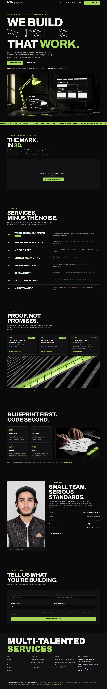

# MTS Portfolio Website

**Portfolio Build Queue #1 — Multi-Talented Services (MTS)**
Owner of the queue: AICOS-116 (Portfolio Curator) · Repo & hosting: AICOS-114 (GitHub, Hosting & Deployment)

- **Industry / type:** Agency — MTS's own shop window; links every demo in this queue
- **Design system:** MTS Core (black/white/lime, typography-first, dark) (house systems owned by AICOS-112)
- **Key integrations (demo data):** Lead form → Google Sheet, WhatsApp click + tracking, GA4/GSC, Meta Pixel
- **Built by:** AICOS-105 (Business Website Builds), with AICOS-112 (Design Systems)
- **Pricing v3 mapping:** — (own asset)

**Status: REBUILT — v2, 2026-11-21 · Visual Quality Scorecard 89/100. See `BUILD-NOTES.md` for the build record and QA verdicts.**

Rules for this repo: one repo per portfolio asset · hosted preview link (Netlify default) once built · this asset is a **DEMO** and is labelled DEMO wherever it is shown · integrations pre-wired with demo data only · QA pass by AICOS-115 before it is shown to any prospect.

**Live preview (one step):** GitHub → this repo → **Settings → Pages → Build and deployment → Source: "Deploy from a branch" → Branch: `main`, folder `/ (root)` → Save.** The site then appears at https://multitalentedservices.github.io/mts-portfolio-website/

---

## Preview — Full-Page Screenshots

**Desktop — full page:**

**Phone — full page:**

